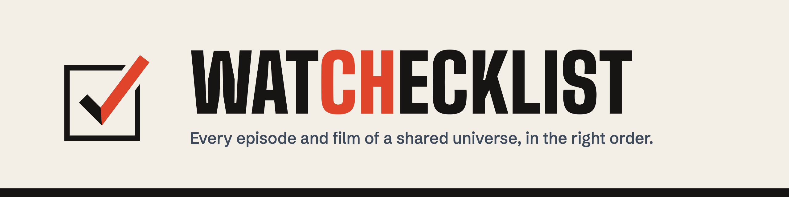

<p align="center">
  
</p>

# watchecklist

Free mobile checklist to watch TV episodes and films in the right order, built for shared
universes with crossovers (episodes from several series interleaved with films).

## Features

- Curated watch orders mixing episodes and films, split into sections.
- One tap to tick an item; an episode shared by several lists is ticked everywhere.
- Filters by type (episode or film), by series and by importance (essential, recommended,
  optional) for a shorter path.
- Short spoiler-free editorial notes.
- French and English.
- Works offline once installed as a PWA.
- No account, no tracking: progress stays on the device, with JSON export and import as a backup.

## Architecture

- Static site: [Astro](https://astro.build), strict TypeScript, no backend.
- List pages are pre-rendered for search engines; a small script adds ticking and filters.
- Progress is stored in `localStorage`, keyed by stable item ids (`tv:<id>:sXXeYY`,
  `movie:<id>`) so editing an order never loses ticks.
- Lists are hand-curated YAML files in `data/lists/`, validated at build time.
- Titles and air dates come from TMDB at build time only. They are never committed to this
  repository and the site never calls TMDB from the browser.
- Hosted as static files, deployed by GitHub Actions on merge to `main` and on a monthly
  schedule to refresh metadata.

## Planned layout

```text
src/            Astro site and its browser scripts
data/lists/     curated watch orders (YAML)
scripts/        list tooling, TMDB sync, data validation
```

## Data sources

This product uses the TMDB API but is not endorsed or certified by TMDB.
Metadata shown on the site comes from [The Movie Database](https://www.themoviedb.org) and is
subject to its terms of use.

## Licences

- Code: MIT.
- Curated list data (order, sections, importance, notes) in `data/`: CC BY-SA 4.0.
- TMDB metadata is not part of this repository and is not covered by either licence.
